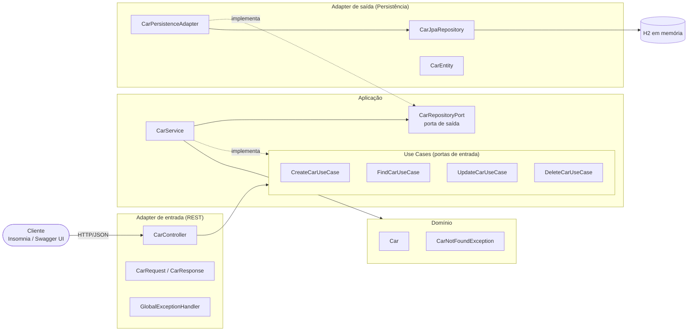

# car-service

Microsserviço CRUD de carros em **Java 21 + Spring Boot 3.5**, com **arquitetura hexagonal**, banco **H2 em memória**, documentação **Swagger/OpenAPI** e cobertura de testes de **100%** medida com **JaCoCo**.

Cada carro tem: `color` (cor), `brand` (marca), `model` (modelo) e `year` (ano).
Ao subir, o banco já vem com 1 carro (id `1`, Toyota Corolla Prata 2022).

## Como rodar

```bash
./mvnw spring-boot:run        # Linux/macOS
mvnw.cmd spring-boot:run      # Windows
```

| Recurso      | URL                                   |
|--------------|---------------------------------------|
| API          | http://localhost:8080/api/v1/cars     |
| Swagger UI   | http://localhost:8080/swagger-ui.html |
| OpenAPI JSON | http://localhost:8080/v3/api-docs     |
| H2 Console   | http://localhost:8080/h2-console (JDBC URL `jdbc:h2:mem:carsdb`, user `sa`, sem senha) |

A especificação OpenAPI exportada também está em [`docs/openapi.json`](docs/openapi.json).

## Endpoints

| Método | Rota                 | Descrição               | Sucesso          | Erros     |
|--------|----------------------|-------------------------|------------------|-----------|
| POST   | `/api/v1/cars`       | Cria um carro           | `201 Created`    | `400`     |
| GET    | `/api/v1/cars`       | Lista todos os carros   | `200 OK`         | —         |
| GET    | `/api/v1/cars/{id}`  | Busca um carro pelo id  | `200 OK`         | `404`     |
| PUT    | `/api/v1/cars/{id}`  | Atualiza um carro       | `200 OK`         | `400`, `404` |
| DELETE | `/api/v1/cars/{id}`  | Remove um carro         | `204 No Content` | `404`     |

Corpo de POST/PUT:

```json
{ "color": "Preto", "brand": "Honda", "model": "Civic", "year": 2024 }
```

## Testes e cobertura

```bash
./mvnw verify
```

O relatório HTML do JaCoCo é gerado em `target/site/jacoco/index.html`. O build falha se a cobertura de instruções, branches ou linhas ficar abaixo de 100%.

## Insomnia

A collection está em [`insomnia/car-service-collection.json`](insomnia/car-service-collection.json). Para importar: **Import → From File**. A variável `base_url` fica no ambiente base (`http://localhost:8080`).

## Apresentação e documento

Material de apoio (Java, API, Swagger e boas práticas) em [`docs/apresentacao`](docs/apresentacao):

- [Slides (PowerPoint)](docs/apresentacao/java-api-swagger-boas-praticas.pptx)
- [Documento (Word)](docs/apresentacao/java-api-swagger-boas-praticas.docx)

## Desenho técnico



As dependências apontam sempre para dentro: os adapters conhecem a aplicação, a aplicação conhece apenas o domínio e as portas, e o domínio não depende de nada (nem de Spring).

### Estrutura de pacotes

```
com.leowvazd.carservice
├── domain
│   ├── model/Car                       # entidade de domínio
│   └── exception/CarNotFoundException
├── application
│   ├── usecases/                       # portas de entrada (Create/Find/Update/Delete)
│   ├── ports/out/CarRepositoryPort     # porta de saída
│   └── services/CarService             # implementa os use cases
├── adapters
│   ├── inbound/rest/                   # controller, DTOs, mapper, exception handler
│   └── outbound/persistence/           # entidade JPA, repositório, mapper, adapter
└── config/OpenApiConfig                # metadados do Swagger
```
